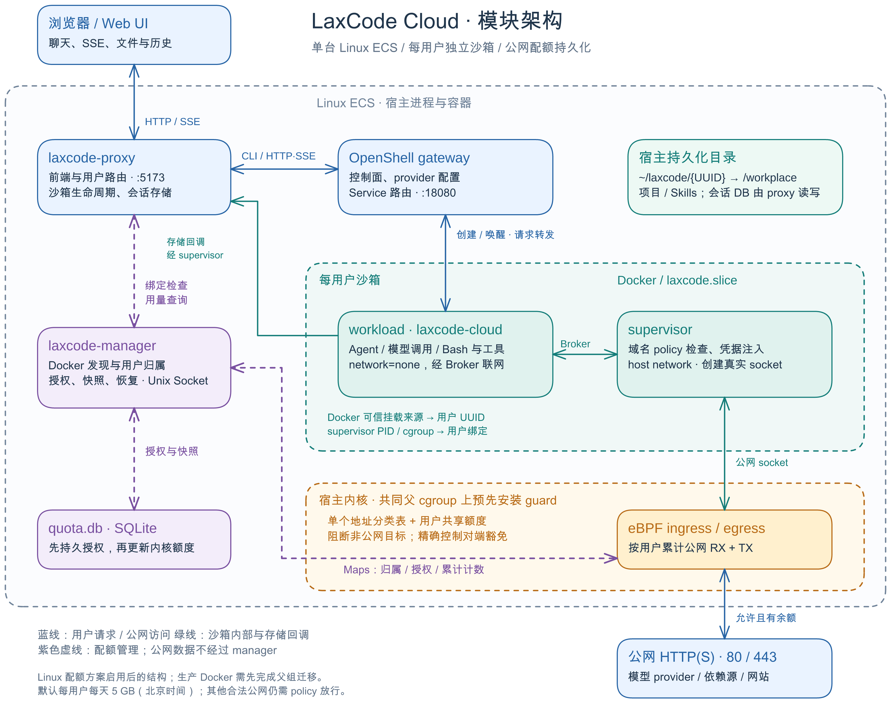

# LaxCode 云Agent



[编辑架构图（Excalidraw）](docs/images/laxcode-cloud-architecture.excalidraw) · [网络配额与首次迁移](laxcode-manager/README.md)

用于单实例 OpenShell 云端部署，本地模式由其他独立分支维护。

宿主机运行 Docker、OpenShell 0.1.4 和 laxcode-proxy；Linux 公网配额由独立的 laxcode-manager 与内核 eBPF 执行。proxy 提供前端，通过 `X-USERID` 将请求转发到每用户独立沙箱；laxcode-cloud 和 Bash 工具在 workload 中执行，supervisor 负责网络策略与凭据注入。

```sh
# 在 deploy/defaults/settings.json 中配置预置模型和真实 API Key
make build-cloud
mkdir -p ~/laxcode_deploy
cp deploy/deploy.sh deploy/laxcode.tar.gz ~/laxcode_deploy/
~/laxcode_deploy/deploy.sh restart
# 浏览器访问 http://localhost:5173
```

详见 [部署与更新](deploy/README.md)、[模型配置](docs/settings.md)。先按部署文档预装依赖和固定基础镜像。默认构建本机 proxy + Linux cloud 发布包，`TARGETOS=linux TARGETARCH=amd64 make build-cloud` 可交叉编译 ECS 发布包。旧 nas 默认配置和 Skills 已迁移到 deploy/defaults。

宿主 `~/laxcode/{user_id}` 持久化用户 HOME、项目、会话、Skills 与模型选择。空闲沙箱停止后复用；更新应用时重新创建沙箱，保留用户文件。模型密钥由 OpenShell 管理，用户仅从预置模型中选择。

内测版尚无注册登录、计费和套餐权限；访客 UUID 是路由标识。proxy 监听 5173；专用网关仅监听本机回环地址。

## 开发与验证

```sh
make test
make vet
# 前端热更新，API 转发到已启动的本机 proxy
pnpm --dir web dev  # http://localhost:5174
```

Go 1.26.6、Node/pnpm、Python 3 和 Docker 是构建依赖。首次浏览器访问包含操作引导；聊天支持 SSE、项目文件清单和下载、会话性能汇总及后台评估。API 细节参见 docs，所有业务请求均需 `X-USERID`。
