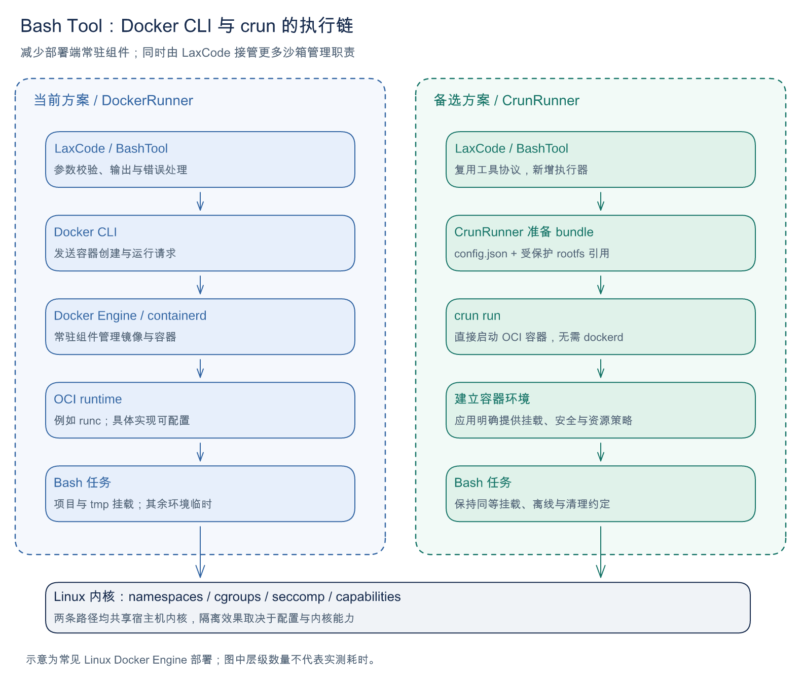
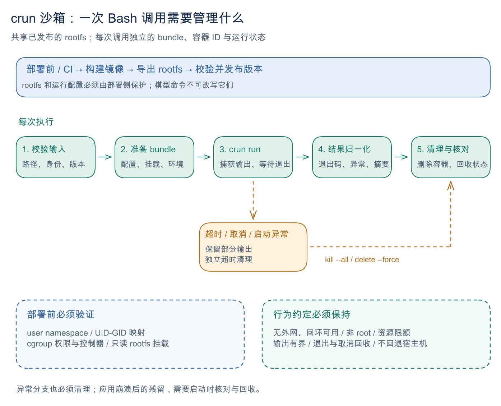

# 用 crun 替代 Docker CLI 执行 Bash Tool：优势与实现难点

日期：2026-10-15。状态：方案评估，暂不实施。本文以 LaxCode 当前 `DockerRunner` 为比较基线，未进行 crun 性能或隔离实测。

crun 对 LaxCode 最明确的价值，是让部署机可以不安装和维护 Docker Engine，直接使用预先准备的 rootfs 执行短生命周期 Bash 任务。相应地，镜像运行环境、安全策略和异常回收中原先由 Docker 提供的部分能力，需要由 LaxCode 和部署流程接管。是否值得迁移，首先取决于部署约束，其次才是性能。

## 1. 两种方案分别负责什么

图 1：左侧是当前方案，右侧是候选方案的准备与执行流程。图中的层级数量不代表实际耗时。[可编辑 Excalidraw 源文件](images/crun-docker-execution.excalidraw)。

Docker CLI 通过 API 请求 Docker daemon，由后者管理容器。crun 则是直接运行 OCI 容器的底层运行时，读取 bundle 中的 `config.json` 和 rootfs 配置；它不提供完整的 Docker 镜像管理功能。[Docker 架构](https://docs.docker.com/get-started/docker-overview/#docker-architecture)、[crun 命令文档](https://github.com/containers/crun/blob/main/crun.1.md)。

当前实现已经针对 Bash Tool 做了以下约束：

| 维度 | 当前 DockerRunner 的行为 |
|---|---|
| 生命周期 | 每次 Bash 新建容器，正常退出自动删除，返回前还会显式清理 |
| 网络与镜像 | `--network=none`，保留容器回环；`--pull=never`，运行时不拉取镜像 |
| 文件与权限 | 项目和用户 tmp 可写，用户 Skills 包只读执行，均保持相同绝对路径；非 root、只读根文件系统、清空 capabilities、禁止提权 |
| 资源 | 2 CPU 配额、1 GiB 内存、无额外 swap 配额、256 个进程/线程；容器 `/tmp` 为 256 MiB tmpfs |
| 输出与错误 | 合并 stdout/stderr，最多捕获 32 MiB；区分命令非零退出与执行异常；失败时附加离线说明 |

对应入口是 [DockerRunner](../internal/infrastructure/shell/docker.go)、[BashTool](../internal/domain/tools/bash.go) 和 [ShellRunner 接口](../internal/domain/tools/shell.go)。评估 crun 时，应以这些行为保持一致为前提。

## 2. crun 的主要优势

### 2.1 部署端可以移除 Docker Engine 依赖

部署包可以由 LaxCode 程序、crun、版本化 rootfs 和配置模板组成。部署机不再需要为 Bash Tool 维护 dockerd、Docker 镜像存储和 Docker socket 访问。

这尤其适合只运行固定离线工具链、又不希望安装完整 Docker Engine 的 Linux 机器。rootfs 中已有 Go、Python、rg，运行任务时无需安装这些开发依赖。

但部署机仍需要可用的 Linux namespaces、挂载、cgroups 和 seccomp 等能力；crun 的动态库或静态构建兼容性也要纳入发布验证。发行版禁止创建 user namespace 或无法委派 cgroup 时，单独复制 crun 可执行文件无法解决问题。

### 2.2 更贴合固定工具链、短生命周期任务

LaxCode 当前每次只需要执行一段 Bash，并保留项目和用户 tmp 文件。crun 可以围绕这一目标直接生成最小 OCI 配置，明确控制进程参数、挂载、环境、资源限制和清理过程。

工具链仍可在 CI/CD 中通过 Dockerfile 构建。部署端接收固定 rootfs 版本，减少运行时对镜像标签、镜像导入等操作的依赖。

离线运行本身并非新增收益：当前 Docker 方案已经禁止自动拉取镜像，也支持预先导入离线镜像。

### 2.3 有机会减少组件开销，但性能需要测量

直接调用 crun 可以省去 Docker CLI 到 daemon 的请求和部分容器管理步骤。对于大量短命令，这值得验证。

目前不能据此断言“启动快几倍”或“内存一定更少”。两种方案都需要创建 namespace、挂载目录、设置 cgroup 并启动进程；crun 方案还增加了应用生成 bundle 的步骤。Go 编译等较长任务的耗时也可能远大于启动差异。

公平比较应在同一台 Linux 机器上，使用内容一致的工具链、同等隔离和清理策略，分别测量简单命令、Python 启动、Go 测试，以及并发执行时的 P50/P95 总耗时。当前 Docker 方案使用本地已有镜像，基准中不能把下载镜像的时间算入 Docker 单次调用开销。

### 2.4 可以缩小授权入口，但需要专门设计

采用 rootless crun 时，LaxCode 可以不接触高权限 Docker socket。采用受限的特权启动器时，也可以将授权限定为固定 rootfs、固定项目范围和固定资源策略。

这项收益取决于实现。若给服务账户任意 `sudo crun` 权限，并允许其提交任意 bundle、宿主机挂载或 hooks，仍可能获得广泛宿主机权限。减少组件数量并不自动提高隔离强度；两种方案都共享宿主机内核。

## 3. 实现难点：需要接管的六类职责

### 3.1 运行权限和 cgroup 委派

这是应最先验证的可行性条件。`process.user.uid/gid` 指定容器内业务进程身份，并不授予启动器创建 namespace、挂载或配置资源限制的权限。

| 运行方式 | 主要难点 |
|---|---|
| Rootless crun | user namespace 是否可用、UID/GID 映射、挂载权限、cgroup 控制器委派，以及文件写入权限 |
| 特权启动器调用 crun | 严格限制 bundle、挂载来源、hooks 和进程配置；保护宿主机授权边界 |

Rootless 资源限制通常依赖 cgroup v2 和正确的控制器委派。CPU、memory、pids 应分别检查实际生效值；不能为了运行成功而静默禁用资源限制。[Rootless cgroup 配置说明](https://rootlesscontaine.rs/getting-started/common/cgroup2/)。

### 3.2 安全默认值需要显式补齐

Docker 参数不能机械翻译成 OCI 字段。迁移时至少需要逐项核对：

| 目标 | crun/OCI 侧需要明确提供的内容 |
|---|---|
| 禁止外网，允许容器内回环 | 独立 network namespace，确认回环启用，不配置外部接口或路由 |
| 目录隔离 | 独立 mount namespace，只读 rootfs，项目和用户 tmp 可写，Skills 包只读；其他 agenthome 文件不暴露 |
| 最小进程权限 | 正确的 UID/GID、空 capabilities、`noNewPrivileges`，以及明确的附加组策略 |
| 系统调用限制 | 适配目标架构并经过验证的 seccomp 配置 |
| 基础系统环境 | 容器自己的 `/proc`、`/dev`、必要设备和需要的 tmpfs；屏蔽或只读处理敏感路径 |
| 信号与僵尸进程 | 显式使用 Tini 等 init 程序，或实现并验证等价回收行为 |

未声明的 namespace 类型会继承运行时所在 namespace，因此遗漏 `network` 可能直接破坏离线约束。`linux.init: true` 也不能替代 Docker 的 `--init`，它不是该 OCI 版本的标准字段。[OCI Linux 配置](https://github.com/opencontainers/runtime-spec/blob/v1.0.2/config-linux.md)、[OCI Linux schema](https://github.com/opencontainers/runtime-spec/blob/v1.0.2/schema/config-linux.json)。

Docker 在支持的环境中提供默认 seccomp 策略。直接运行 crun 时，应明确提供所需策略；“默认允许全部，只禁止少数调用”的配置不能视为与 Docker 默认策略等价。[Docker seccomp 文档](https://docs.docker.com/engine/security/seccomp/)。

### 3.3 挂载、临时目录与路径语义

建议保留当前目录约定：项目和用户 tmp 可读写，用户 Skills 包只读，均挂到容器中的相同绝对路径；`HOME` 位于临时文件系统，`GOPATH` 放在持久挂载的用户 tmp 下。这能继续使用现有工具路径和提示词。

如果改为统一的 `/project`，就需要处理模型命令、文件工具返回路径和工作目录之间的对应关系。单纯修改挂载目标容易造成“文件工具能读到，Bash 却找不到”的问题。

OCI 挂载要使用实际支持的选项；Docker 的 `bind-recursive=disabled` 不是通用 OCI mount option。同一目标目录重复挂载时，后挂载内容会遮住前面的内容，例如先 bind 用户 tmp 到 `/tmp`，再挂 tmpfs 到 `/tmp`，就无法看到用户 tmp。[OCI mount 规则](https://github.com/opencontainers/runtime-spec/blob/v1.0.2/config.md#mounts)。

共享只读 rootfs 还需要验证挂载点准备方式、并发运行和运行时是否会修改底层目录。不能在没有验证的情况下，假定给所有任务引用同一个目录就已具备安全的共享行为。

### 3.4 rootfs 发布、完整性和更新

`docker create + docker export` 可以提取 rootfs，但发布物还需要补充 CPU 架构、版本和校验信息。导出文件系统不携带完整镜像运行配置，挂载卷内容也不会被导出；PATH、HOME、USER、工作目录和启动命令等需要在 OCI 配置中恢复。[Docker export 文档](https://docs.docker.com/reference/cli/docker/container/export/)。

文件权限、符号链接、归属和必要元数据需要在打包、解压时正确保留。PATH 必须包含工具链位置，例如 Go 的 `/usr/local/go/bin`。

建议将 rootfs 作为部署侧管理的不可变版本：先解压到新目录并校验，供新任务选用；正在运行的任务继续引用旧版本，确认没有使用者后再回收。工具链和系统库的安全更新也需要重新构建并发布 rootfs。

bundle 中的 `config.json`、运行状态和发布的 rootfs 应位于 Agent 无法改写的位置。特别是在使用特权启动器时，不能从已挂载给 Agent 的项目或 tmp 目录读取可被替换的高权限运行配置。

### 3.5 取消、退出和残留回收

图 2：正常和异常分支都要完成回收；进程崩溃后的残留还需要后续核对。[可编辑 Excalidraw 源文件](images/crun-bash-lifecycle.excalidraw)。

每次调用需要独立的容器 ID 和 bundle。应用应跟踪启动状态、取消函数和完成信号，处理正常退出、非零退出、部分启动失败、超时、请求取消及进程崩溃。

当前 DockerRunner 已经提供可复用的做法：输出有界、保留部分结果、清理使用独立 Context、清理失败保留记录。crun 方案仍需要明确管理容器和后代进程，不能只依赖结束 crun CLI。crun 提供 `kill --all` 和 `delete --force`；具体调用顺序、与 `run` 的竞争及状态不存在时的处理都要验证。[crun 生命周期命令](https://github.com/containers/crun/blob/main/crun.1.md#commands)。

生产实现还需要识别服务被强制终止后遗留的容器、cgroup、bundle 和挂载，并按实例归属回收，避免误删其他实例仍在运行的任务。

### 3.6 结果协议、错误诊断和可观测性

可以保持 `ShellOutcome` 和 `ToolResult` 协议，但执行器必须重新区分“用户脚本返回非零”与“运行时无法启动、权限不足、挂载失败或资源配置失败”。当前 DockerRunner 对退出码 125 的处理是 Docker 相关约定，不能直接照搬为 crun 的错误分类规则。

返回内容仍应保留 stdout/stderr、退出码、部分输出、捕获截断标记及离线提示。为定位部署故障，还应记录容器 ID、rootfs 版本、运行时错误和清理结果，并避免记录敏感环境变量。

## 4. LaxCode 可以复用哪些现有设计

替换主要集中在基础设施执行器和装配入口。以下能力可以继续使用：

| 现有设计 | crun 方案的处理方式 |
|---|---|
| `ShellRunner.Run/Close` | 新执行器遵守相同接口和取消语义 |
| `BashTool` 参数、超时和结果处理 | 保留默认 30 秒、最大 60 秒、归档和压缩摘要行为 |
| 32 MiB 输出捕获 | 复用有界输出策略，继续保留超时前日志 |
| 主、子 Agent 执行器工厂 | 各自创建 Runner，避免关闭时互相影响 |
| 项目和 TempDir 的校验 | 保留，并在 bundle 生成和特权边界重复检查 |
| cloud 离线提示词 | 保持无外网、同次调用内完成服务测试、不回退宿主机的约束 |

`BashSandboxed()` 关系到 ReAct 是否跳过原有静态风险检查。新执行器应在隔离能力经过验证后再接入这一标记；切换命令名称本身不足以证明已经具备沙箱能力。

配置生成应使用结构化 JSON 编码，将模型命令作为 `process.args` 中的单个字符串，避免拼接或模板替换破坏参数边界。

## 5. 选择建议与后续验证范围

| 实际条件 | 更合适的选择 |
|---|---|
| 已有稳定 Docker Engine，目标是尽快完成公测 | 保持当前 DockerRunner |
| 部署机明确不能安装 dockerd，且可以提供合适的内核、权限和 cgroup 条件 | 值得验证 crun |
| 主要目标只是让 Bash 调用更快 | 先测量当前启动开销，再决定是否迁移 |
| 希望复制一个二进制后，无需任何宿主机准备就能安全运行 | crun 仍不能消除 namespace、权限和资源管理前提 |

以后若重新推进，第一步应是在一个明确的目标环境验证 rootless 或受限启动器、网络隔离和 cgroup。通过后，再用同一 rootfs 和同等安全策略比较性能，最后才接入 LaxCode。

最小验证范围应覆盖：

1. 项目与用户 tmp 正常读写，Skills 脚本和资源只读执行；agenthome 中的配置、会话数据和宿主机敏感目录不可访问，符号链接不能扩大访问范围。
2. 容器内 HTTP 回环测试成功，外部 IPv4/IPv6、DNS、宿主机回环服务不可访问；挂载目录也不得暴露可用于绕过隔离的宿主服务 socket。
3. 非 root 身份、只读根文件系统、capabilities、禁止提权、CPU/内存/pids 限制实际生效。
4. Go、Python、rg 及本地构建可用；不同调用之间只有项目和用户 tmp 保留。
5. 超时、取消、后台进程、启动失败、并发调用和服务异常退出后，进程与运行状态能正确回收。
6. 正常输出、超大输出、非零退出与运行时失败，均符合既有工具返回协议。

本文中的 crun 收益属于基于执行路径的工程分析，尚无 LaxCode 场景下的性能数据或目标机器验证结果。当前决定是保留 Docker 实现，将本方案作为部署环境受限时的候选路径。

## 6. 插图维护

插图由 Excalidraw 源文件生成，PNG 和源文件都保存在 `docs/images/`。修改时以保存到磁盘的 `.excalidraw` 为准，重新渲染并检查文字、连接线和边界后更新 PNG。

中文使用系统字体渲染，不同机器的导出结果可能略有不同；本文引用的是本次已检查的 PNG。
