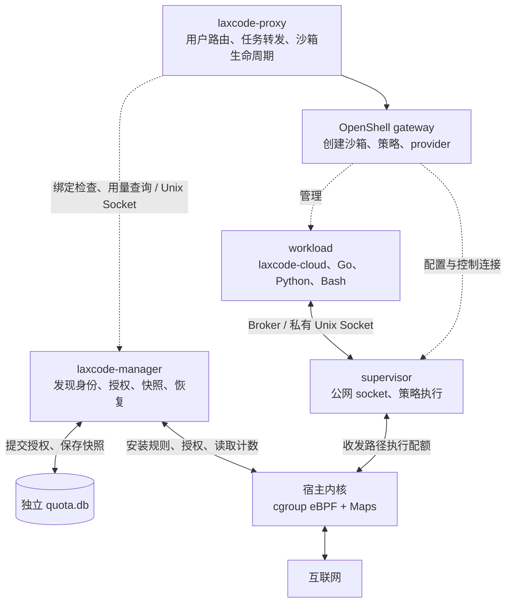
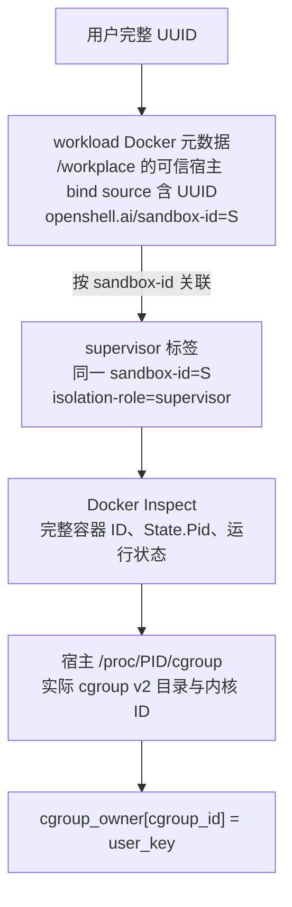
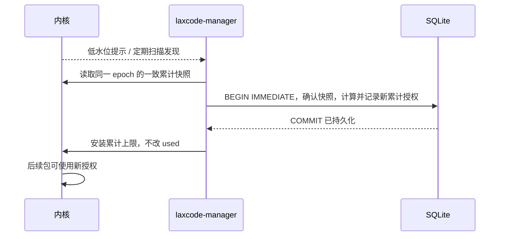
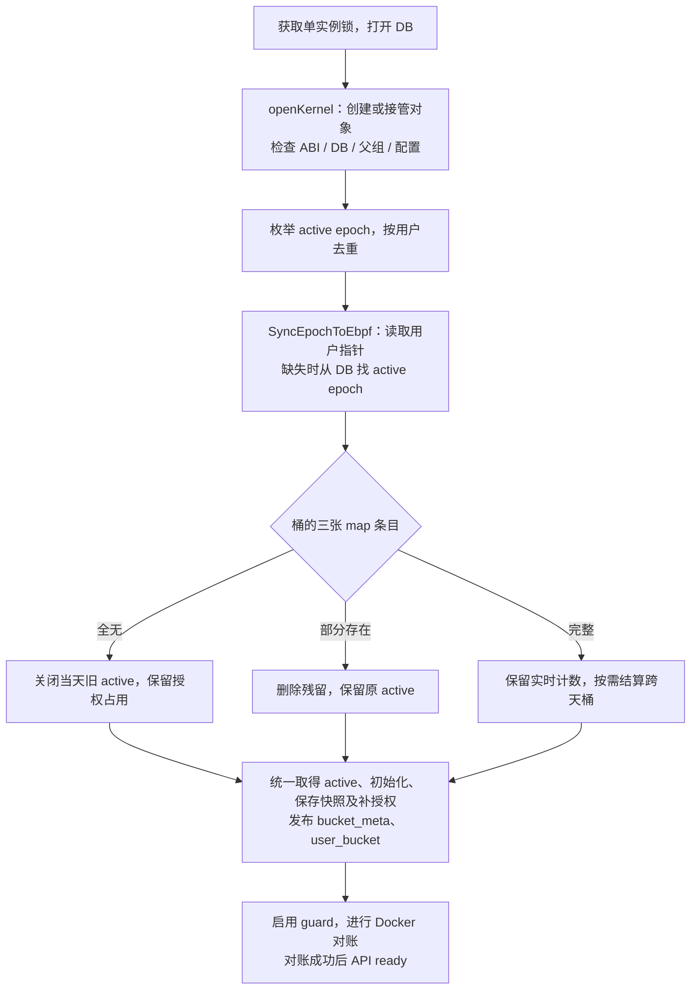

# LaxCode 沙箱公网流量配额设计

状态：首版于 2026-10-20 实现，epoch 同步于 2026-10-26 按 [重构方案](epoch_opt_v2.md) 更新为 ABI/schema 3。采用简洁域名 policy、一个 eBPF 地址分类表和持久配额账本；“任意公网域名”不属于官方 OpenShell 0.1.4 首版已验证能力。操作说明见 [laxcode-manager/README.md](../laxcode-manager/README.md)，验证边界见第 14 节；本次未迁移生产 Docker。

## 1. 需求与结论

运行环境是单台 Linux ECS、Docker driver、OpenShell 0.1.4，每个用户通常拥有一个沙箱。ECS 网络按包月计费；配额用于限制云端 Agent 跑爬虫、持续下载大文件等行为，不作为按字节收费的账单。

目标行为：

- 开放策略覆盖的公网 HTTP(S) 和依赖下载，同时保留 OpenShell 文件系统、进程、凭据及内网访问隔离；两段域名通过部署配置显式补充，不承诺任意网站均可访问。
- 每个用户每天上传、下载合计最多 `5_000_000_000` 字节，即十进制 5 GB；界面可另外显示 GiB。
- 以 `Asia/Shanghai` 自然日计量；北京时间零点进入新额度周期。
- 同一用户的全部 supervisor 共享额度。停止、启动、删除、重建沙箱、发布应用都不能刷新当天额度。
- 达到内核当前授权上限时停止放行相关公网数据包；DB 还有余额则补充授权，当日余额耗尽则次日恢复。
- 掉电后不要求逐字节还原用量；允许一小段授权额度保守占用，但不能因重启重新发放。
- 不修改官方 OpenShell 二进制来实现计量和限额；普通业务流量不绕行 `laxcode-manager`。

采用 **宿主 Go 服务 + cgroup v2 ingress/egress eBPF + 独立 SQLite 账本**。DB 先持久化小批授权，内核消费，manager 定期把累计用量写回 DB。公网用量、授权占用、不确定量分别展示。

这是一项日累计流量控制，不是每秒带宽限制或 HTTP 请求数限制。低流量爬虫仍可能持续运行；本版不另外实现 QPS、并发连接或业务反爬规则。

## 2. 当前仓库与 OpenShell 的事实

| 当前入口 | 已有行为 | 本方案涉及的变化 |
| --- | --- | --- |
| `laxcode-proxy/openshell.go:Create` | 创建时写入 `laxcode-app=laxcode`、`laxcode-user=<完整UUID>`，传入 policy 和 providers | 保留标签；创建/唤醒后增加 manager 绑定就绪检查 |
| `laxcode-proxy/openshell.go:sandboxName` | 名称为 `u-` 加 UUID 的 SHA-256 前缀，总长 19 字符 | 不从名称逆推用户；从宿主可信工作目录挂载取得完整 UUID，再核验名称 |
| `laxcode-proxy/main.go:ensure` | 查找、创建/唤醒沙箱并等待 Ready | 转发用户任务前等待 manager 完成映射 |
| `deploy/configure.py:generate` | 生成内部存储访问策略 | 增加受控的公网出网策略生成与校验 |
| `deploy/Dockerfile.tools` | 旧 v1 为离线工具链 | v2 使用 goproxy.cn、保留 sumdb 校验，加入 pip/venv、curl/git，移除 PIP_NO_INDEX |
| `deploy/deploy.py` | 独立 gateway；应用更新时保留 gateway，重建应用沙箱 | manager 二进制随包发布，账本和 pins 独立保留 |
| `deploy/build.sh` | 打包 proxy/cloud、配置及镜像构建输入 | Linux 发布包增加 manager；无需在运行时安装编译器 |

官方 0.1.4 Docker driver 为一个沙箱创建 workload 和 supervisor 两个容器：

- workload 使用 `network_mode=none`；网络 broker 接管连接，通过经过认证的 Unix Socket 私有通道转交数据。
- supervisor 使用 `network_mode=host`，检查 policy，持有 provider 运行凭据并创建真正的外网 socket。
- 两个容器都有 `openshell.ai/sandbox-id`、`openshell.ai/sandbox-name`、`openshell.ai/sandbox-namespace`；**实机纠正：CLI `--label` 只写 gateway 资源，不写 Docker 的 template.labels，用户环境也不直接写入 Docker Config.Env。**
- workload 的 Docker Inspect `Mounts` 保留 proxy 创建的 `/root/laxcode/<完整UUID> -> /workplace` 绑定；首版以这个宿主控制的来源作为用户身份，配置 `workplaces_root` 严格限定父目录。不读挂载目录里的用户文件或进程环境。
- supervisor 额外有 `openshell.ai/isolation-role=supervisor`，但不能假设它继承 `laxcode-user`。
- 停止后再启动会重新创建 supervisor，因此其容器 ID、宿主 PID 和 cgroup 身份可能变化。

OpenShell gateway 是控制面，不是所有下载流量的转发点。计量对象是 supervisor 外网 socket 所属的 cgroup，不是 gateway 进程、workload 的网卡或某个公网 IP。

## 3. 总体架构与模块边界



### 3.1 laxcode-manager

一个宿主进程承担以下工作，不再拆分多个守护服务：

1. 管理 Docker 发现、用户到 supervisor cgroup 的映射。
2. 加载、挂载、pin 和接管 eBPF 对象，检查 ABI、DB 身份、父组和配置兼容性。
3. 以 DB 事务发放配额，消费补充事件，并定期扫描兜底。
4. 定期保存累计快照，恢复进程重启及内核状态丢失后的账本。
5. 通过宿主 Unix Socket 提供就绪状态和用户用量，不暴露公网管理端口。

manager 是账本和授权配置的唯一写入者。proxy 不直接打开 manager DB，不直接更新 BPF Maps；OpenShell gateway 不增加流量记账职责。

### 3.2 eBPF 程序

只完成有界的逐包工作：识别 socket cgroup、检查必要通信豁免、读取额度、同步累计或丢弃、发送低额度提示。不访问 SQLite，不发起 RPC，不等待 manager。

### 3.3 实现目录

复用仓库根 `go.mod`，新增一个可执行程序包，不创建嵌套 Go module：

```text
laxcode-manager/
├── README.md               # 设计入口、实现状态
├── main_linux.go           # 参数、单实例锁、信号、启动顺序
├── manager_linux.go        # 生命周期、补充、对账与 Unix HTTP API
├── docker_linux.go         # Docker API、PID、cgroup 关联
├── bpf_linux.go            # 对象加载、挂载、pin、Map 访问
├── ledger.go               # SQLite schema、授权与累计快照事务
├── config.go               # 配置校验、共享 ABI
├── addresses.go            # 唯一地址分类表
├── generate.go             # bpf2go 生成入口
├── quota_bpfel.go          # 生成的 Go 绑定，最终名称由生成器确定
├── quota_bpfel.o           # 生成并嵌入的 BPF 对象
├── ebpf/
│   ├── quota.c             # ingress/egress、解析、计数、事件
│   └── quota.h             # 共享 ABI 和所需固定 Linux UAPI
└── *_test.go               # 授权协议、发现和 Linux 集成验证
```

Go 侧使用 `github.com/cilium/ebpf v0.19.0` 加载对象、操作 Maps、管理挂载和读取 Ring Buffer。SQLite 复用已有依赖；Docker 访问使用标准库 `net/http` 加 Unix socket，协商 API 版本并限制请求超时。

## 4. 计量范围与访问边界

### 4.1 计量口径

- 累计 supervisor 公网收发路径被本配额程序放行的 `skb->len`，分别记录 RX、TX；`used = RX + TX`。
- 这是内核 IP 流量口径，不是下载文件大小。协议头、重传及 offload 会影响数值，不承诺与云账单或网卡物理线速统计逐字节一致。
- 被本程序丢弃的数据单独记录 drop 字节和次数，不重复加入“已放行用量”。放行后若被后续网络组件丢弃，仍可能已计入本配额。
- 流量包到达 ECS 后才在 ingress 丢弃，不能把本机制解释成云网络费用的绝对上限；本项目按包月计费，无需解决该问题。
- 模型 provider 的公网请求默认同样计入额度。额度耗尽可能中断模型请求；不默认把模型域名加入豁免。
- proxy 直接服务浏览器的 SSE、文件下载、宿主镜像拉取等，不是 supervisor 公网出网，不计入此额度。

### 4.2 必要通信豁免

只对部署生成的精确对端开放，不整体豁免 RFC1918、所有回环流量或所有 53 端口：

| 对端 | 行为 |
| --- | --- |
| gateway 实际控制地址，例如 `127.0.0.1:18080/TCP` | 允许、不计量；即使用户额度耗尽也要保留控制面 |
| 当前部署的存储私网 IP `:5173/TCP` | 允许、不计量；HTTP 方法和路径仍由 OpenShell policy 限制 |
| 经确认的宿主 DNS resolver 地址与端口 | 允许必要解析、不计量；按实际 TCP/UDP、IPv4/IPv6 配置 |
| 其他内网、回环、链路本地及元数据目标 | 不因本方案扩大权限，默认拒绝；包括云元数据目标 |
| 其他合法公网对端 | 绑定用户后按额度计量；OpenShell policy 还必须允许 |

本表指 supervisor 的对外连接。已核验 `network=none` workload 自己的隔离网络回环另按 6.4 节处理，不代表放开宿主回环。

eBPF 按 ingress/egress 区分远端地址和端口：发出方向取目的地址/端口，接收方向取源地址/端口。IPv4-mapped IPv6 必须归一化；不能通过地址表示差异绕过内网限制。无法完整解析必要通信规则时不得误判为豁免。

地址分类集中在一个 `BPF_MAP_TYPE_LPM_TRIE` 中：IPv4 统一编码为 mapped IPv6，最长前缀匹配返回 PUBLIC/BLOCK，未匹配默认 BLOCK。精确必要通信先匹配；其余非公网在用户映射和额度检查之前拒绝。网段表固定在代码中，不做运行时域名解析或在线更新，不在每个 provider 中重复展开公网 CIDR。不能用 `!IsPrivate()` 或 `IsGlobalUnicast()` 替代公网分类。

2026-10-20 ECS 调研确认 DNS 为 `100.96.0.2/3`，火山云元数据为 `100.96.0.96`。前者只按精确 IP、TCP/UDP 53 豁免，后者由 `100.64.0.0/10` 拒绝，不能整体放开该网段。上述地址是验证记录，实际配置仍从部署环境生成。

### 4.3 放开公网与配额是两项独立变更

采用 **简洁域名 policy + 一个 eBPF 地址分类表 + 原有配额逻辑**。eBPF 放行不会覆盖 OpenShell 的拒绝规则；工具镜像也必须同时开启依赖下载。

2026-10-20 已在实际 ECS（OpenShell 0.1.4、Docker 29.9.1、Linux 7.2.11）验证：

- **hostless 路线前置验证未通过。** 添加公网 `allowed_ips` 会与当前 provider 的空 `allowed_ips` 冲突；统一后虽能创建沙箱，普通 HTTP(S) 仍因 `policy_dns_ineligible` / `transparent_tcp_observation_denied` 被拒绝。透明网络路径的 DNS 关联要求非空 host，不能把 legacy forward-proxy 能力当作当前 Docker driver 的全域名支持。
- `host: "*"`、`host: "**"` 和两段通配不受支持。`**.*.*` 覆盖三段及以上域名，`github.com`、`goproxy.cn` 等两段域名需精确列出。任意 HTTP(S) 网站是独立的 OpenShell 能力前置项，首版不修改官方二进制或依赖校验漏洞来绕过。
- 不带公网 CIDR 的域名规则可以兼容现有 provider；但通配规则也可能匹配 IPv4 字面地址。无 guard 时实测访问宿主私网 `:80` 得到 308，因此 **必须先安装并验证 eBPF guard，再放宽 policy**。
- 已允许域名的 HTTP/HTTPS、公网重定向、虚构 provider 凭据注入成功。全新缓存经 `goproxy.cn` 下载 Go 模块并验证 sumdb 成功；官方 `proxy.golang.org` 在宿主也超时，不据此判断 policy 失败。
- 一个匿名 LPM Map 的 20 条分类原型通过 21 个 IPv4/IPv6/mapped 地址案例。该结果不等同于逐包 BPF、完整网段表、性能或公网 IPv6 连通性的验收。

首版策略只开放 HTTP(S) 的 80/443，保留内部存储专用 5173 规则及 provider 凭据检查，不配置 `tls: skip` 或任意协议隧道。重叠端点的连接和检查元数据必须一致。更新工具镜像标签和下载配置，保留 `GOTOOLCHAIN=local`。部署必须确认策略在 supervisor 中达到 `Loaded`，不能把 CLI 提交成功当作生效；失败保持拒绝，不禁用隔离或凭据检查。

任意 UDP、QUIC、ICMP、原生 IP 直连不在本版范围。公网接入验收按最终配置的域名集合进行，不能写成“全面开放公网”。

## 5. 用户、沙箱、容器、cgroup 的映射



发现算法：

1. manager 启动先全量枚举 Docker 容器，再监听事件；断流、重连后必须重新全量枚举，另每 5 秒对账一次。
2. 对 workload 校验 `managed-by=openshell`、预期 namespace/role；`/workplace` 必须是唯一 bind mount，其 Source 必须严格等于 `<workplaces_root>/<完整UUID>`。用现有 `sandboxName` 算法验证名称。Docker 挂载来源由宿主创建，沙箱进程修改目录内容或环境变量不能改变它。
3. 在同一 namespace 中按 sandbox-id 关联 role 为 supervisor 的运行中容器。不能把 sandbox-id 当用户 UUID，不能假设自定义标签传播到 supervisor。
4. 读取容器完整 ID、宿主 PID、进程启动时间，再读取宿主 `/proc/<PID>/cgroup`。只接受 cgroup v2 项和受管父 cgroup 内的目录。
5. 打开目录并获得与 `bpf_skb_cgroup_id()` 一致的 64 位内核 cgroup ID；使用 `name_to_handle_at` 等经目标内核验证的办法，不能哈希路径或截断容器 ID 代替。校验 PID/容器身份未在读取期间发生变化。
6. 注册 `cgroup_id -> user_key`。一个用户允许多条运行时映射，最终指向同一个当日 quota bucket。
7. stop/destroy 后清理旧映射；新 supervisor 必须重新关联。不要因一个 cgroup 消失就清空用户累计量或关闭仍可复用的用户 bucket。

manager 在 Docker 容器处于运行态时就可以绑定，不等待 OpenShell Ready。否则若 supervisor 的就绪检查需要访问 provider，就会形成“等待 Ready 才绑定、未绑定又不能访问 provider”的启动死锁。proxy 的 Ready 后检查是确认流程，不是唯一发现入口。

`user_key` 使用 DB 分配的正整数主键，不使用可能碰撞的 UUID 短哈希。cgroup 路径和 PID 只供发现与诊断，不能作为持久账本主键。

## 6. 在首次出网前建立拦截

### 6.1 为什么不只做逐容器挂载

仅靠 Docker `start` 事件，再向 supervisor cgroup 挂载 BPF，会有“进程先出网、manager 后安装”的窗口。proxy 等待绑定可以阻止新聊天提前运行，但不能完全覆盖恢复中的后台任务。

生产设计使用 **预先挂载到专用共同父 cgroup 的一组 BPF 程序**，让未来创建的子 cgroup 自动受约束。此前讨论的“按每个 supervisor cgroup 计量”仍成立；区别是挂载在父组，归属通过 socket 的具体子 cgroup ID 查表。

### 6.2 单台专用 ECS 的部署选择

- 建立受管 `laxcode.slice`，Docker daemon 配置默认 `cgroup-parent=laxcode.slice`。OpenShell 不需要修改二进制。
- 在 Docker 启动容器之前，manager 先在该 slice 安装 ingress/egress 程序。未知 cgroup 只能访问精确的必要通信对端，不能访问其他公网。
- 识别并绑定 supervisor 后才授予公网额度。workload 本身没有外部网络；identity/staging 容器没有用户公网授权。
- manager 自身、gateway 和 Docker daemon 位于该受管 slice 之外；不要把程序挂到整个宿主根 cgroup 或 `system.slice` 来误伤其他服务。
- 本选择会改变该 Docker daemon 下所有新容器的默认父组。因此首版要求专用 Docker 工作负载；其他容器不能被自动标成“不计量放行”。共享 Docker 主机需要另行隔离，不直接套用本配置。
- 已存在的容器不会自动迁移。首次开启时停止并重建 LaxCode 沙箱，逐个确认 supervisor 位于受管 slice；发现越界则 readiness 失败，proxy 不接收任务。

Docker 父组配置在制作 ECS 基础镜像时完成；应用部署只启动 slice 并核验实际父组，不再执行 systemd manager 安装或 Docker 迁移。基础环境准备必须在专用 Docker 无现存业务容器时完成。

### 6.3 启动就绪分层

当前部署由 `deploy.py` 直接启动 manager，不安装 systemd 服务。Docker 可随基础系统自启，但 OpenShell 容器必须保持无自动重启策略。手动部署时先完成 DB 打开、对象接管/加载、父组 guard 安装及 Docker 对账，再启动 gateway/proxy 和业务沙箱。宿主重启后需手动部署；不得让业务容器先于 guard 自动恢复。代码保留可选的 systemd ready 通知，但当前部署不使用。

对 proxy 的 `/readyz` 则要求 guard、DB、Docker 对账完成且距最近成功对账小于 10 秒。Docker 事件断开自动重连，5 秒全量对账兜底；对账失败撤销归属并标记未就绪。DB/Map 不变量异常使 guard 关闭，修复原因后重启接管；manager 进程直接退出则内核仍可消费原授权。

### 6.4 workload 内部回环

OpenShell 0.1.4 的 `network=none` workload 在创建控制套接字前，会通过本网络命名空间内的回环 TCP 做启动自检。父组 guard 覆盖 workload，因此不能把它与 supervisor 访问宿主回环混为一谈。

manager 核验 workload/supervisor 的 Docker 身份、独立 cgroup、workload 的 `network=none` 和非宿主网络命名空间后，在已有 `cgroup_owner` 表中用值 0 标记 workload（真实用户主键始终为正数）。eBPF 只豁免该标记对应的 IPv4/IPv6 回环通信；未核验 workload、supervisor 对宿主回环的访问以及其他非公网目标继续拒绝。标记随容器发现同步撤销，不增加 Map、不改变账本或 Map ABI；guard 未就绪时仍拒绝。

## 7. eBPF Maps、ABI 与数据面

### 7.1 Map 设计

生产采用共同父 cgroup 挂载，因此不能直接用父组的 `CGROUP_STORAGE` 区分用户。采用固定容量 HASH Maps，禁止使用会自动淘汰额度状态的 LRU Map。

| Map | Key | Value / 所有权 |
| --- | --- | --- |
| `metadata` | 固定 key | ABI 版本、DB ID、配置哈希、父组 ID、ready 与低水位；manager 初始化和校验 |
| `cgroup_owner` | `u64 cgroup_id` | 正数为 supervisor 的 user_key；0 为已核验隔离 workload 的回环标记；manager 写 |
| `user_bucket` | `u64 user_key` | `u64 bucket_id`；manager 发布当前周期 |
| `bucket_meta` | `u64 bucket_id` | 用户和单调时钟截止时间；日期由 DB 中 bucket 关联，发布后不可原地修改 |
| `grants` | `u64 bucket_id` | 累计授权上限；manager 写，eBPF 只读 |
| `usage` | `u64 bucket_id` | spin lock、RX、TX、drop、通知节流状态；eBPF 写，manager 读取 |
| `control_peers` | 固定长度对端结构 | 精确 IP、协议、端口豁免；manager 发布 |
| `address_class` | 128 位规范地址及前缀长度 | 一个 LPM Trie，PUBLIC/BLOCK；固定规则由 manager 加载 |
| `events` | Ring Buffer | userID 低水位提示，不是账本 |
| `diagnostics` | 有界原因编号 | 未绑定、过期、额度不足、解析错误、事件丢失等计数 |

所有跨边界结构使用固定宽度整数及显式 padding，不存 Go string、指针、浮点 GB 或路径字符串。IPv4/IPv6 地址、端口的字节序在头文件中固定；C/Go 生成绑定校验 `sizeof`、offset、对齐和端序。

额度与计数分开，manager **不得读取旧 `used` 后，把包含新额度的整个 usage value 写回**，否则会覆盖并发增长的计数。`grants` 使用 HASH element 的整项发布；同一 active epoch 的 grant 只增。manager 是唯一写入者，补额度按用户串行处理；迟到结果必须验证 active epoch 和 bucket 身份。

`usage` 的 RX/TX 合计检查与累加使用同一 `bpf_spin_lock`，不能只对两个独立计数器各做一次原子加法。快照使用支持锁的 Map lookup 读取一致的 RX/TX。helper 调用、Map lookup、时间读取、Ring Buffer 操作都放在持锁区之外；锁内只做有界内存检查及修改。

### 7.2 逐包逻辑

```text
提取方向、远端地址/协议/端口
  guard 未就绪：DROP
  cg = bpf_skb_cgroup_id(skb)
  若 cgroup_owner[cg] 为保留值 0 且为回环地址：PASS（仅已核验隔离 workload）
  若精确匹配必要通信对端：PASS，不计入用户额度
  若 address_class 最长前缀匹配不是 PUBLIC：DROP
  查询 cgroup_owner[cg]、user_bucket[user]、bucket_meta、grants、usage
  任一映射缺失、组不受管、周期过期：DROP
  读取当前时间、授权快照；获取 usage 锁
    以减法检查：len <= granted - used，先验证 used <= granted
    够用：累加本方向字节
    不够：增加 drop 统计，不增加已放行用量
    判断是否需要低水位通知
  释放锁；按需发通知
  返回 PASS 或 DROP
```

入口为 `SEC("cgroup_skb/egress")` 与 `SEC("cgroup_skb/ingress")`，GPL license。只挂载一层受管父组，避免父子组重复挂载导致重复计量。

归属必须来自 socket 的 cgroup。不能在接收路径简单用 `bpf_get_current_cgroup_id()`，那可能得到正在处理网络的线程身份，而非发起连接的 supervisor。`bpf_skb_cgroup_id()` 返回 0 或在目标内核不能可靠取得归属时，受管流量不得默认放行；兼容性验证失败就不能启用本方案。

包解析使用 `bpf_skb_load_bytes` 等有界访问，覆盖 IPv4、IPv6、必要扩展头和非线性 skb；循环有编译期上限。不完整解析不能匹配控制豁免。公网普通流量不需要解析 HTTP、解密 TLS 或读取请求正文。

### 7.3 容量、持久引用与对象升级

首版 Map 固定容量：4096 个用户指针、8192 个 cgroup/bucket、64 个控制对端、128 个地址前缀；满表报错并关闭 guard，不能淘汰余额。旧日 bucket 在跨天同步时保存快照、关闭 epoch，切换用户指针后异步清理旧条目。

Maps 和 BPF links pin 到 `/sys/fs/bpf/laxcode-manager/`，目录仅宿主管理员可写。pin 保持内核引用，不是落盘，不能跨宿主重启。程序升级优先复用兼容 Maps；ABI 不兼容时拒绝接管。显式维护必须先停止应用并确认父组无进程，再由 reset_quota.py 验证保留账本并清理 pins，重新部署 guard 后才启动业务。不能在沙箱仍运行时卸载 guard。

## 8. 账本结构与一致性协议

### 8.1 独立数据库

DB 位于 `/var/lib/laxcode-manager/quota.db`，不放进应用发布目录或用户挂载目录，不复用用户 `sessions.db`。使用 SQLite WAL、`synchronous=FULL`、busy timeout、外键；同目录 `manager.lock` 防止两个 manager 同时发放授权。DB 实例 ID 必须与内核 metadata 中的 DB ID 匹配，不能直接采用旧余额覆盖内核。

单行账本 metadata 仅保存 DB 实例 UUID；schema 版本由 PRAGMA user_version 保存。恢复比较现存内核的累计授权与 DB；内核授权超过 DB 视为异常。若 DB 和内核状态同时丢失，仅凭旧 DB 备份不能自动证明它是否最新：备份恢复必须走显式运维恢复流程，在决定保守占用前保持公网拒绝，不能伪装成普通进程重启。

下列是设计字段含义；可执行 schema 以 `ledger.go` 为准，实际表名为 `metadata/users/user_days/epochs`，`PRAGMA user_version=3`。`epochs` 另存 BOOTTIME `deadline`，其余列采用简短的 `id/user_id/granted/rx/tx` 命名：

```sql
CREATE TABLE users (
  user_key INTEGER PRIMARY KEY AUTOINCREMENT,
  user_uuid TEXT NOT NULL UNIQUE
);
CREATE TABLE user_days (
  user_key INTEGER NOT NULL REFERENCES users(user_key),
  day TEXT NOT NULL,
  limit_bytes INTEGER NOT NULL CHECK (limit_bytes >= 0),
  PRIMARY KEY (user_key, day)
);
CREATE TABLE quota_epochs (
  bucket_id INTEGER PRIMARY KEY AUTOINCREMENT,
  user_key INTEGER NOT NULL,
  day TEXT NOT NULL,
  status TEXT NOT NULL CHECK (status IN ('active', 'closed')),
  granted_bytes INTEGER NOT NULL DEFAULT 0 CHECK (granted_bytes >= 0),
  confirmed_rx_bytes INTEGER NOT NULL DEFAULT 0 CHECK (confirmed_rx_bytes >= 0),
  confirmed_tx_bytes INTEGER NOT NULL DEFAULT 0 CHECK (confirmed_tx_bytes >= 0),
  updated_at TEXT NOT NULL,
  FOREIGN KEY (user_key, day) REFERENCES user_days(user_key, day),
  CHECK (confirmed_rx_bytes + confirmed_tx_bytes <= granted_bytes)
);
CREATE UNIQUE INDEX one_active_epoch
  ON quota_epochs(user_key, day) WHERE status = 'active';
```

首版不提供手工退款、减少已授权额度或自动回收失联授权的功能。正常 stop/start 继续复用同一用户日 bucket；内核计数丢失时旧授权保守占用到当天结束，翌日重新开始，避免复杂回收协议。

每天的展示字段从 epoch 汇总计算：

- `confirmed_used_bytes = SUM(confirmed_rx_bytes + confirmed_tx_bytes)`。
- `held_bytes = SUM(granted_bytes)`：当天已经持久化发放的总额度，包括旧 epoch。
- `allocatable_bytes = limit_bytes - held_bytes`：DB 还可以发给内核的额度。
- `uncertain_bytes`：仅 status=`closed` 的 `granted - confirmed_used` 总和。
- 活跃 epoch 的 `granted - used` 是内核尚可消费的额度，不应展示成已使用。

实时接口可以在 DB 确认值基础上合并同一 epoch 的内核最新累计值，但不能把持久化授权直接当实际用量。所有字节数使用 64 位整数，并检查溢出与不变量。

### 8.2 分批授权

默认目标可用批次 `B=16 MiB`、低水位 `W=4 MiB`；这两个数是初始配置，不是吞吐能力承诺。设当前 epoch 的 DB 已授权为 `G`，内核一致快照已用为 `U`，当天所有 epoch 的已授权合计为 `H`，日上限为 `Q`。

在同一个 `BEGIN IMMEDIATE` 事务中：

1. 验证用户、日期、active epoch 及 `0 <= U <= G`；幂等更新确认的 RX/TX。
2. 如果内核尚未安装 DB 已提交的授权，先安排恢复该授权，不把同一个请求当成新充值。
3. 计算 `delta = min(max(0, U + B - G), Q - H)`，所有中间值检查范围。
4. `delta > 0` 时更新 `granted_bytes = G + delta`。事务提交后才更新内核 `grants[bucket]`。
5. `delta = 0` 且 DB 无剩余时记录当日额度已全部发放；内核可以继续消费已发放但未用完的余额，真正耗尽后停止。

该算法把可消费的超前授权控制在一个配置批次附近，同时每次发放都确认一次累计快照；不反复叠加完整批次造成大额未确认授权。



授权消息使用累计上限，不使用“加 16 MiB”式增量。每用户只允许一个补充流程在运行；重试以 DB 累计授权为准，已提交结果可以重复安装而不会重复发放。旧 epoch 转为 closed 后，迟到的 checkpoint 不得再发放授权；manager 单实例锁和互斥锁串行保护这些操作。

### 8.3 内核用量回写

- 默认每 1 秒读取一致的累计快照；申请下一批前也必须读取。
- 按 bucket_id/epoch 更新累计值。新快照不小于 DB 的已确认总量时，一次更新 RX/TX；旧快照或重复快照是无害重试，不能做 `used += delta`。
- `usage` 的计数仅由 BPF 修改；manager 不周期性拿 DB 快照覆盖内核。
- 写 DB 失败保留内核计数并关闭 guard；修复后重启接管，不允许把计数清零。
- Ring Buffer 不作可靠记账日志，丢失事件不影响 Map 中的累计用量。

### 8.4 为什么不能掉电后直接恢复 DB 的 used

若 DB 最后确认 10 MiB，内核实际已用 11 MiB，DB 授权 16 MiB，掉电会丢失内核计数。此时只能确定实际用量在 10～16 MiB 之间。直接以 10 MiB 重建、重新发放差额，会让已用的部分被再次使用。

处理方式是将旧 epoch 置为 `closed`，保留其 16 MiB 授权占用；新 epoch 从当天尚未发放的额度申请。界面仍显示已确认 10 MiB、旧 epoch 待确认 6 MiB，不把 16 MiB 伪装为实际使用。由于用途是防滥用，可以接受该保守误差；多次主动破坏状态不能获得更多额度。

## 9. 补充通知、事件丢失与额度耗尽

通知仅包含 `userID`；manager 收到提示调用该用户的 `SyncEpochToEbpf` 重新读取 Map 和 DB，不把通知当账本。这样无需信任丢失或迟到的事件内容。

- 剩余低于 W 时通知，仍继续使用当前授权，不等待 DB。
- 同一桶按单调时钟以 1 秒间隔节流通知和重试，避免逐包事件风暴。
- Ring Buffer 写入可能因容量不足失败；事件丢失计数递增。manager 每 1 秒全量扫描活跃用户 bucket，与快照任务共用扫描结果，补足丢失通知。
- 授权已耗尽但 DB 仍有余额时，补充完成前临时 drop；TCP 可能暂停和重传。不要排队保存全部数据包，也不改成内核内同步 RPC。
- DB 无可发额度时，不必继续每秒写无变化的拒绝日志；只在状态变化时记录。
- manager 停止时内核最多继续消费已授权额度，耗尽后 drop；运行中检测到 DB 错误则关闭 guard。未知组和过期周期始终拒绝公网。

## 10. 启动、重启、日切与发布恢复

### 10.1 manager 启动



`openKernel` 保留 ABI、DB UUID、父 cgroup、配置哈希及 Ready 校验；不匹配时禁用 guard 并拒绝启动。进程重启不关闭全部 active，启动和运行中的恢复都由 `SyncEpochToEbpf` 按用户串行完成。部分桶条目仅视为初始化中断，删除后按 DB 重建；三项全无才保守关闭当天旧 active。跨天、首次授权、丢失 maps、部分初始化共同进入同一处重建代码。

显式维护使用 `reset_quota.py`：停止应用/manager、确认父 cgroup 无进程、持有部署锁及 manager 锁，验证账本后移除专属 pins。脚本保留账本，可在部分删除失败后重试；不得直接 rm pins 或清空账本。ABI 3 中 grants 为 8 字节、usage 为 48 字节、metadata 为 72 字节。此次重构仅修改新建表结构，schema 3 不自动迁移旧数据；部署前按已清空旧数据的约定准备新表。

### 10.2 cgroup 重建

同一开机期间和日期下，一个用户的 bucket 独立于 supervisor 生命周期。新 cgroup 只绑定现有 user_key，继续消费原 bucket；清理旧 cgroup 不回收用户状态。短暂存在两个 supervisor 时仍共享一个受锁保护的累计量。

### 10.3 自然日切换

manager 负责墙上时间到北京时间日期的转换；eBPF 不自行解释时区。每个 bucket 有单调时钟截止时间，避免 manager 故障后旧日授权无限延续。

跨天同步时先取得当前日 active epoch，保存旧桶快照并关闭旧 epoch，然后统一初始化新桶 usage、持久化首批授权并发布 grants/bucket_meta，最后切换 `user_bucket` 到新 bucket。旧 bucket 截止后只允许必要通信；零点 manager 不在线时允许暂时停止公网，不能继续使用过期授权。跨零点的长连接从后续数据包开始计入新 bucket，不要求重连。

旧指针仍可能被在途 BPF 调用持有；计量线性化到其使用的有效 bucket，允许日边界存在少量在途误差，不以物理线缆时间实现逐包跨日结算。本次接受快照至切换间少量漏计；旧条目由同用户锁保护的异步清理回收，排除执行清理时的当前 epoch。

本轮删除墙钟跳变和记账日期回退检测。每次同步取得用户锁后只取一次 day，后续计算均使用该日期。时区数据随 Go 二进制嵌入，固定北京时间。

### 10.4 故障矩阵

| 故障 | 行为 |
| --- | --- |
| DB 授权提交前崩溃 | 没有新授权，内核不能使用它 |
| DB 已提交、Map 尚未安装 | 同 epoch 重装绝对累计上限，不重复充值 |
| Map 已安装、manager 收到响应前退出 | 接管后比对 DB 累计授权，重复安装无害 |
| 内核已累计、DB 快照未保存 | 同 boot 读取 pinned 计数补写 |
| ECS 重启或运维脚本清理 Maps | 旧 epoch closed，授权继续占用；新 epoch 从余下额度发放 |
| 正常应用发布、proxy 重启 | 不重启额度周期；重新发现 cgroup |
| Ring Buffer 满、Docker 事件断流 | 定期扫描/全量对账兜底；未知组保持拒绝 |
| DB 恢复旧备份、Map ABI 不明 | readiness 失败，人工诊断；不静默初始化 |
| 用户额度耗尽 | 保留控制面/内部存储；公网停用，proxy 返回可读错误 |

## 11. 与 laxcode-proxy 的集成接口

manager HTTP 仅监听 `/run/laxcode-manager/control.sock`。socket 使用宿主权限和可选 `SO_PEERCRED` 校验调用者；不通过沙箱挂载，不接收公网请求。首版不增加管理员任意修改用户额度的 API。

| 接口 | 语义 |
| --- | --- |
| `GET /healthz` | 进程存活，不等同于可发放额度 |
| `GET /readyz` | guard、DB、Docker 初次对账已完成，版本匹配 |
| `POST /v1/sandboxes/{sandbox_id}/ensure` | 重新核对容器标签并等待绑定；幂等，带超时 |
| `GET /v1/users/{uuid}/network-usage?day=YYYY-MM-DD` | 查询该用户当日/历史配额，不触发沙箱启动 |

`ensure` 不接受客户端直接指定 cgroup 或任意 user_key；从 Docker 标准标签和可信挂载来源重新关联。返回 `user_id/sandbox_id/code/reset_at`，以 HTTP 200/429/503 表示已绑定/耗尽/不可用；proxy 核对返回身份。详细额度通过用量接口查询，避免重复接口字段。proxy 对外增加 `GET /api/network-usage?day=YYYY-MM-DD`。

proxy 在 `ensure` 等待 OpenShell Ready 后调用 manager，再转发用户任务。manager 不可用或未绑定时返回 503；当日已确认不可继续公网时，新聊天/评估任务可返回 429 和下一次北京时间重置时间。已有任务可能从 socket 收到网络错误，不能保证一定转换成 HTTP 429。文件、历史、报告等宿主数据接口仍可用。

用量响应至少区分：`limit_bytes`、`observed_used_bytes`、`confirmed_used_bytes`、`held_bytes`、`allocatable_bytes`、`uncertain_bytes`、`exhausted`、`updated_at`。实时内核不可读时返回已确认值及 stale 标志，不能把未知显示为 0。

按整包放行会留下不足一包的余额。首版在全部额度已发放且余额不足 128 字节时，将 `exhausted` 置 true，拒绝启动新 HTTP(S) 任务；内核仍检查实际字节余额，未使用零头不计作已用量。

当前部署的 `X-USERID` 仅为内测身份标识，没有登录验证。**生产按用户配额的前提是入口认证后绑定稳定 UUID，并覆盖客户端自行提供的身份头。** 否则攻击者换 UUID 就能领取新额度，eBPF 和 manager 无法解决这个业务身份漏洞。

## 12. 构建、部署与配置

### 12.1 构建

- manager 首版仅支持 Linux amd64/arm64；macOS 保持当前开发流程，不宣称本机可执行 Linux cgroup eBPF。
- 开发/CI 使用固定版本 clang/LLVM、BPF 头文件和 `bpf2go` 编译 C 并生成绑定。正式运行只需要 Go 二进制及内核支持，不在线安装依赖。
- 采用 CO-RE 构建时检查目标内核 BTF；实际以所用 helper、Maps、spin lock、Ring Buffer 和 link/pin 能力探测为准，不只判断内核版本字符串。
- `go generate ./laxcode-manager` 生成对象后，使用 `CGO_ENABLED=0 GOOS=linux GOARCH=<目标>` 构建；已有 SQLite 依赖支持无 CGO 路线。构建脚本和 manifest 增加 manager 哈希。
- 生成文件与输入版本一并固定，ABI 改动必须显式升级 schema；不能在发布时隐式下载“最新”BPF 代码。

### 12.2 运行位置

```text
/root/laxcode_deploy/laxcode/bin/laxcode-manager # 随包发布的宿主程序
/root/laxcode_deploy/state/manager.json           # 管理配置
/var/lib/laxcode-manager/quota.db           # 持久账本与 DB 身份
/run/laxcode-manager/control.sock          # proxy 调用
/var/lib/laxcode-manager/manager.lock       # 单实例
/sys/fs/bpf/laxcode-manager/               # pinned Maps / links
```

Linux 按 root 后台进程部署，由 deploy.py 管理 PID，原因是需要 Docker socket、宿主 PID/cgroup、BPF 加载与挂载权限；这些权限本身具有宿主管理能力。不要把 manager 放到用户沙箱里，也不向 workload 暴露 Docker socket 或 manager socket。后续有实际需求再细化 capabilities，不在首版增加权限代理服务。

配置示例（控制对端地址必须替换为首次部署探测的实际地址）：

```json
{
  "docker_socket": "/var/run/docker.sock",
  "sandbox_namespace": "laxcode",
  "workplaces_root": "/root/laxcode",
  "cgroup_parent": "/sys/fs/cgroup/laxcode.slice",
  "state_dir": "/var/lib/laxcode-manager",
  "socket_path": "/run/laxcode-manager/control.sock",
  "pin_path": "/sys/fs/bpf/laxcode-manager",
  "daily_limit_bytes": 5000000000,
  "grant_chunk_bytes": 16777216,
  "refill_low_watermark_bytes": 4194304,
  "control_peers": [
    {"address": "127.0.0.1", "port": 18080, "protocol": "tcp"},
    {"address": "192.168.1.5", "port": 5173, "protocol": "tcp"},
    {"address": "192.168.1.1", "port": 53, "protocol": "tcp"},
    {"address": "192.168.1.1", "port": 53, "protocol": "udp"}
  ]
}
```

必要通信对端从已验证的 gateway/store/DNS 配置生成，不能硬编码本文示例。校验 `0 < W < B <= Q`、路径归属、目录权限、Map 容量以及 DB 整数范围。

域名入口为 `deploy/defaults/network.json`，部署时 `/root/laxcode_deploy/network.json` 优先覆盖，格式 `{"additional_domains":["example.com"]}`；重新执行 `python3 deploy.py` 生效。它只补充域名，不改变内核地址分类或日额度。配额配置位于 `/root/laxcode_deploy/state/manager.json`，二者使用和维护步骤见 manager README。

### 12.3 固定目录发布顺序

1. 基础镜像完成 Docker 父组、内核和运行镜像准备；应用包固定 Linux amd64，包含 deploy.py。
2. 下载单一 tar.gz，使用 `tar --unlink-first` 直接覆盖固定目录；不备份旧包、不使用临时发布目录或目录切换。
3. deploy.py 校验制品和宿主，停止 proxy、清理旧沙箱、重启 manager；保留配置、账本和 pinned 对象。
4. guard 就绪后启动/复用 gateway，删除剩余旧沙箱，生成新 policy 和公开配置。
5. 离线构建固定 laxcode-cloud:current，删除旧应用镜像；注册 provider 并启动 proxy。
6. 不自动回滚；需要旧代码时从 TOS 下载旧制品重新部署，不能恢复旧 DB、清空账本或卸载 guard。失败后检查日志并重试；ABI 或 pinned 配置不兼容需单独维护迁移。

## 13. 可观测性与错误处理

`/readyz` 提供 ABI、父组、namespace、绑定数、最近对账时间、错误原因及 per-CPU 拒绝计数汇总（解析、地址、未绑定、过期、配额、事件丢失）。用量接口提供最后确认时间；日志记录对账、DB 和不变量错误，重复相同错误合并。首版不增加 metrics server。

日志不记录 provider 凭据或用户请求正文。逐包拒绝只累计计数，不产生逐包日志；累计授权和用量保留于 SQLite。

`/readyz` 不可用必须显示具体原因。核验失败时不自动禁用 guard；告警用户侧可能发生网络暂停，而不是返回误导性的成功。

## 14. 实施阶段与验收

### 阶段 0：验证实现前提

在与 ECS 相同的 Linux/Docker/OpenShell 0.1.4 环境，使用一次性测试沙箱验证：

- workload/supervisor 标签、宿主 PID、cgroup ID 的实际关联；stop/start 和发布重建后的变化。
- 专用父组继承的 BPF 在子组首次出网前生效，unknown 默认拒绝而控制面仍可连接。
- `bpf_skb_cgroup_id()` 在 ingress/egress 和 host-network supervisor 上可靠归属；IPv4/IPv6、已有 TCP 长连接均被覆盖。
- provider 组合策略、Go 新依赖、校验服务和重定向下载；固定可执行的策略生成办法。
- BTF、spin lock、locked snapshot、Ring Buffer、pin 与跨进程接管可用；记录 kernel、Docker、OpenShell 和依赖版本。

任一关键前提失败，不跳过身份关联或网络保护。已实现的功能不等于完成所有生产验收；下表列出当前测试范围及仍未验证项。

### 阶段 1：最小可运行实现

实现 manager 单进程、DB schema、父组 guard、Map 管理、标签发现、共享用户 bucket、16 MiB 批次授权、1 秒快照/补充扫描、Unix Socket readiness。先通过本地接口观察，不新增前端控制台或 gateway 扩展。

### 阶段 2：接入业务与部署

接入 proxy 绑定检查和用量接口；构建 manager、工具镜像及公网 policy；部署生命周期独立管理。先对测试用户使用较小额度完成耗尽、日切与故障恢复，再使用正式 5 GB 配置。

### 必须验证的测试

| 类别 | 关键断言 |
| --- | --- |
| 授权协议 | 并发补充不超发；累计上限重试不重复发放；确认值单调；DB 与 Map 写之间各故障点可恢复 |
| 共享额度 | 同用户两个 cgroup 共用一份额度；不同用户互不影响；多连接双向累计不超过安装上限 |
| 发现 | 错误 namespace/role、缺失 UUID、重复关联、PID 复用、cgroup 越界、Docker 断流均不能错绑或放开未知组 |
| 数据面 | 并行上传/下载、IPv4/IPv6、长连接、TLS、非线性 skb、控制豁免、畸形包、Map 满及 Ring Buffer 满 |
| 恢复 | kill manager 后规则仍在；重启服务保留内核计数；销毁 Maps/宿主重启不返还未知授权；stop/start 不刷新余额 |
| 周期 | 北京时间日切、跨日连接、manager 跨零点离线、迟到旧快照与旧补充结果；本轮不含时钟跳变检测 |
| 业务 | 新 Go 模块下载成功；额度耗尽后停止公网且内部存储正常；用户轮换身份头不能绕过认证后的 UUID |
| 性能 | 对比启用前后吞吐、CPU、尾延迟、DB 写频率和锁竞争；目标值依据 ECS 实测确定，不能用未测数字代替 |

普通 Go 单元测试使用临时 DB 和伪 Map/Docker 响应；真实 BPF、Docker、重启故障测试显式启用，运行于隔离 Linux 环境。文档自身检查相对链接、SQL schema 与 Mermaid，不把设计伪代码误认为可编译程序。

### 2026-10-20 首版验证记录

本地完成 `go test ./...`、`go test -race ./laxcode-manager ./laxcode-proxy` 和部署 Python 测试（13 项）；manager Linux amd64/arm64 交叉编译通过，BPF 对象由 clang 19.1.7 生成。ECS 使用 Linux `7.2.11-1.el9.elrepo.x86_64`、Docker `29.9.1`、官方 OpenShell `0.1.4`。

| 已执行项目 | 结果与证据 |
| --- | --- |
| 真实内核 guard | 共同父组挂载、未知子组拒绝、精确控制豁免、非公网拒绝、两个子组共享额度、双向计数、单调截止、pinned 接管通过；128 KiB 测试中 RX 128,944 + TX 588 字节未超上限 |
| 地址分类 | 真实 LPM Map 的 IPv4、IPv6、mapped 及特殊地址案例通过；IPv6 公网传输未测试 |
| 持久授权恢复（首版历史验收） | DB 提交后 Map 尚未更新的恢复、相同 pins 接管、丢失内核状态后的保守占用、配置身份不符时关闭 guard、部分 pins 缺失通过；首版时钟跳变检测已在 epoch 重构中删除 |
| 实际 OpenShell 关联 | 从可信 `/workplace` bind source 得到 UUID，按标准标签关联 supervisor；越界父组 readiness 拒绝，进入隔离受管父组后绑定成功 |
| policy 与 provider | 公网 policy 状态为 `loaded`，active version 与提交版本一致；现有 provider 配置可组合，虚构测试凭据注入通过，未读取或输出真实凭据 |
| 公网与依赖 | goproxy.cn 模块信息、api.github.com 返回 200；全新缓存下载 `github.com/google/uuid@v1.6.0` 并完成校验 |
| 内网及元数据 | 私网 IP 和 `100.96.0.96` 请求超时，内核 address_drop 增长；回环非控制端口被拒绝 |
| 进程重启 | 实际下载后 kill -9 manager，再启动接管；已确认用量和累计授权没有清零 |
| 实际耗尽 | 1 MiB 日额度下载大文件被截断；最终累计 1,048,556 ≤ 1,048,576 字节，quota_drop 为 93，ensure 返回 429 / NETWORK_QUOTA_EXHAUSTED，OpenShell 内部执行通道仍可用 |
| proxy 与部署边界 | 单元测试覆盖执行前 429/503、缓存 endpoint 重新绑定、身份不匹配、用量查询不唤醒沙箱、域名输入校验、guard readiness 和默认父组部署预检 |

实际 OpenShell 测试使用独立临时 DB/pins/父组，先以离线 policy 创建沙箱，再把测试 supervisor 放入已挂载 guard 的父组，绑定成功后才热更新公网 policy。此举只用于隔离验证，**不能替代生产 Docker 默认父组迁移**。测试沙箱使用宿主已有 v1 工具镜像并显式设置下载环境，因此也不能视作 v2 发布镜像的完整构建验收。

仍未执行：生产安装器迁移、完整宿主重启、v2 镜像和完整发布包构建、IPv6 公网传输、吞吐/锁竞争压力、Map/Ring Buffer 满容量，以及真实零点长连接和 PID 高频复用压力。私网域名样例在 DNS 阶段解析失败，未据此宣称完成 DNS rebinding 端到端验证；最终目标地址分类由真实内核分类及私网 IP 请求验证。首次正式启用应在维护窗口完成迁移及这些环境相关验收。

### 2026-10-22 单包部署验证记录

在 Ubuntu 24.04、内核 6.8.0-142-generic、Docker 29.9.2、官方 OpenShell 0.1.4 的 ECS 上，使用独立测试目录和虚拟模型凭据验证：

- 本机交叉编译 Linux amd64，唯一制品 `release/laxcode.tar.gz` 包含 deploy.py；manifest、三个 ELF 架构及仅文件条目的 tar 格式验证通过。
- 首次部署、运行中 `tar --unlink-first` 原目录覆盖、第二版默认重启、同版重复部署、stop 后重启均通过。发布目录 inode 不变，无临时发布目录或旧版本备份。
- 旧沙箱和旧应用镜像删除，仅保留 `laxcode-cloud:current`；废弃程序/Skills 文件清除。适配 Docker 29 已自动回收旧 manifest 的情况。
- 用户文件、manager 配置、DB 身份、BPF map-set 和父 cgroup 保留；更新前后确认用量均为 16,034 字节，累计授权均为 16 MiB，没有清零。已删除 workload 的回环标记正常撤销。
- 实际运行包内 laxcode-cloud，通过 OpenShell service 路由检查健康并访问公网 HTTPS；未调用真实模型。容器自动重启策略确认为 no。
- 20 项 Python 部署/配置测试、Go manager/proxy 回归以及 ECS 上全部内核/账本测试通过。内核回归覆盖未知组阻断、隔离 workload 的 IPv4/IPv6 回环、非回环阻断、guard 未就绪阻断、宿主回环阻断、共享双向配额和 pinned 恢复。

本次发现并修复：全父组 guard 会拦截 OpenShell workload 的本地回环启动自检；此前只移动 supervisor 的验证未覆盖该条件。修正复用 `cgroup_owner` 的保留值 0，不增加 Map，不改变账本/Map ABI。实际整机重启、TOS 上传及真实模型调用不在本轮验证范围；跨 boot 的陈旧 PID 识别由单元测试覆盖。

### 14.3 epoch 同步重构验证（2026-10-26）

- ABI 3 的 C 对象和 Go 绑定由 clang 19 重新生成；Linux amd64 构建及 arm64 集成测试编译通过。
- 在隔离的 Docker Linux 内核上运行完整集成测试：共享配额、独立 workload 回环、用户 ID ring 事件、pins 接管、维护重建，以及 ABI/DB UUID/父 cgroup/配置/Ready 不匹配时拒绝并关闭 guard 均通过。
- 新增同步测试覆盖 16 种三张 map 完整性与用户指针组合、发布 user_bucket 失败后恢复、跨天及跨天中断重试、同用户并发、目标用户用量查询不受其他用户锁阻塞、追加授权保留 live usage、异步清理失败重试与保护当前 epoch；Linux race 检查通过。
- macOS 账本与 proxy race 测试、部署脚本 25 项测试通过。未部署 ECS，未操作用户的实际 DB/pins，未进行整机重启或真实午夜长连接验收。

## 15. 主要取舍与未解决前置项

| 选择 | 原因与代价 |
| --- | --- |
| 独立 manager + SQLite | 不把逐包职责加入 proxy/gateway；多一个宿主服务，但应用发布不重置账本 |
| 父组预挂载 guard | 消除逐容器异步安装窗口；需要专用 Docker 父组和首次迁移 |
| socket cgroup 归属 | 不依赖共享公网 IP、UID 或动态源端口；需要内核实际能力验证 |
| DB 先授权、实际用量异步确认 | 防止重启重复领取；内核丢失后可能保守占用未用完的一批额度 |
| HASH Maps + 共享锁 | 不自动淘汰余额，保证双向合计；高并发时需实测锁竞争 |
| 不自动退款未知授权 | 满足防滥用、避免恢复协议复杂化；不是精确计费系统 |
| 单宿主单写者 | 复用当前部署规模；未来多 ECS 不能直接复制此 DB 发放相同额度 |

已验证的域名策略与未通过的 hostless 路线见 4.3；逐包内核与恢复验证结果及未测边界见 14。Docker 父组迁移、完整宿主重启及性能仍需部署环境验收。认证后的稳定用户身份也是生产前提。“任意公网域名”需单独解决 OpenShell 的准入能力，不能只完成 manager 编码就认定已经实现。

## 16. 参考依据

- [OpenShell 0.1.4 Docker driver 运行模型与上游代理](https://github.com/NVIDIA/OpenShell/blob/v0.1.4/crates/openshell-driver-docker/README.md)
- [OpenShell 0.1.4 容器标签与构造源码](https://github.com/NVIDIA/OpenShell/blob/v0.1.4/crates/openshell-driver-docker/src/lib.rs)
- [OpenShell 0.1.4 policy schema](https://docs.nvidia.com/openshell/v0.1.4/how-it-works/policies/schema)
- [Docker cgroup 发现](https://docs.docker.com/engine/containers/runmetrics/)
- [Docker 默认 cgroup parent](https://docs.docker.com/reference/cli/dockerd/#default-cgroup-parent)
- [Linux cgroup ingress/egress BPF program types](https://www.kernel.org/doc/html/v6.9/bpf/libbpf/program_types.html)
- [Linux socket cgroup helper 实现及允许的程序类型](https://github.com/torvalds/linux/blob/v6.12/net/core/filter.c)
- [Linux HASH Maps 与同步](https://docs.kernel.org/bpf/map_hash.html)
- [Linux cgroup storage 的挂载组语义](https://docs.kernel.org/bpf/map_cgroup_storage.html)
- [Linux Ring Buffer 语义与满队列行为](https://docs.kernel.org/bpf/ringbuf.html)
- [Linux BPF 对象 pin 接口](https://kernel.org/doc/html/latest/userspace-api/ebpf/syscall.html)
- [cilium/ebpf 与 bpf2go](https://github.com/cilium/ebpf/blob/main/cmd/bpf2go/README.md)
- [SQLite 事务隔离](https://sqlite.org/isolation.html)与 [WAL/FULL 持久性](https://sqlite.org/pragma.html#pragma_synchronous)

源码依据为已核对的 OpenShell `v0.1.4`，commit `5a7728c304b5528e954e9ae900cf21f84e1a12b1`。升级 OpenShell 或 Docker driver 时，必须重新验证容器拓扑、标签、出网来源和 policy 行为。
