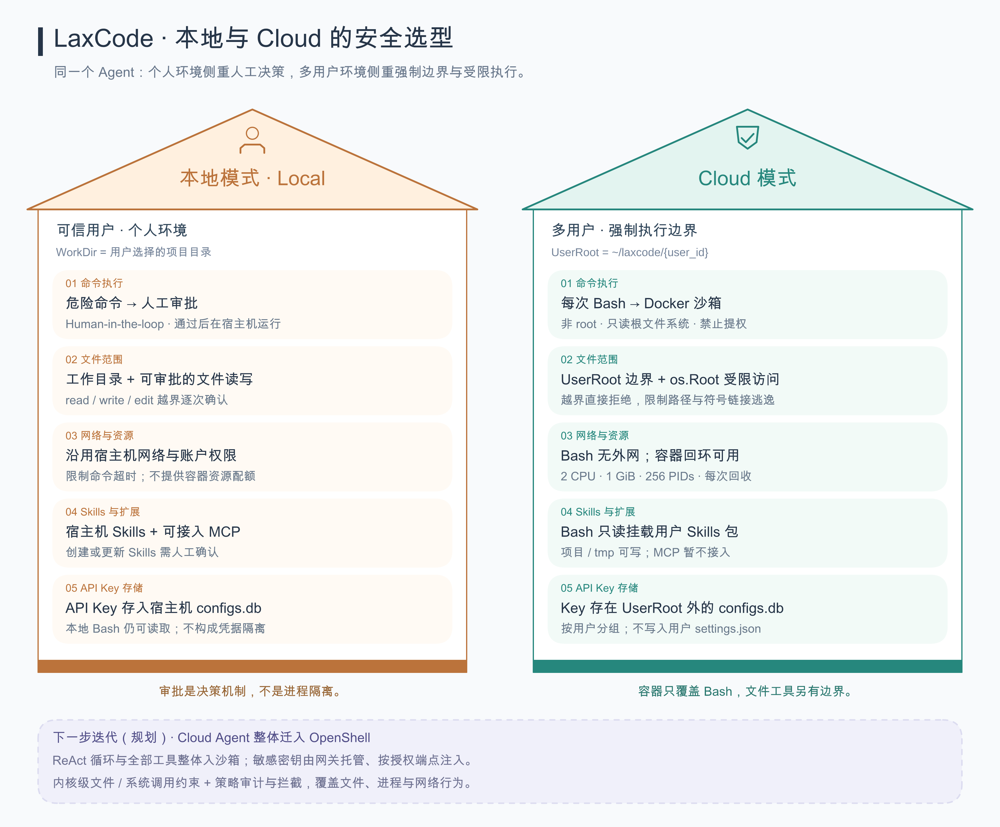

# 本地模式与 Cloud 模式：安全选型对比

第一版草图，按 2026-10-15 的实现核对，供后续 README 使用。



[可编辑 Excalidraw 源文件](images/local-cloud-security.excalidraw)。PNG 为 3360 × 2780，适合直接嵌入 GitHub README：

```markdown

```

两栋房子的五层依次比较命令执行、文件范围、网络与资源、Skills 与扩展、API Key 存储。左侧以个人用户的人工决策为主要入口，右侧通过用户目录边界和 Bash 容器限制执行范围。底部虚线框展示下一步 OpenShell 迭代规划，与房屋内的当前实现分开。

当前实现的补充说明：

- 本地模式对静态检查识别出的危险 Bash 命令发起审批；普通命令不逐条审批。批准后的命令在宿主机以运行账户权限执行，人工审批不构成操作系统隔离。
- Cloud 的 Docker 沙箱只覆盖 Bash。`read_file`、`write_file`、`edit_file`、`grep`、`glob` 仍在宿主机执行，并受 `UserRoot` 限制；不是每个 session 都运行在独立容器中。
- `UserRoot` 是允许访问的目录路径，`os.Root` 是受限文件访问使用的目录句柄，两者不是同一种对象。图中的“UserRoot 边界 + os.Root 受限访问”表示路径策略与实际访问限制配合；Bash 的隔离仍由 Docker 挂载范围和容器配置提供。
- `UserRoot = ~/laxcode/{user_id}`，Bash 只挂载当前项目、用户 tmp 和用户 Skills 包。项目与 tmp 可写，Skills 挂载只读；`create_skill`、`update_skill` 等宿主机专用工具仍可更新当前用户的 Skills。
- `--network=none` 限制的是 Bash 容器。容器回环可用，服务、就绪检查、测试与结束服务需要在同一次 Bash 调用内完成；后端访问 LLM 不受这个容器网络设置约束。
- API Key 在服务账户的 `~/.laxcode/configs.db` 中按用户、provider、model 保存；该 SQLite 文件并未加密。Cloud 用户配置不包含这些 Key，Bash 不挂载凭据库；本地 Bash 没有同等的凭据访问隔离。OAuth 不在本图比较范围内。
- 容器共享宿主机内核。图示不代表已经完成公网身份鉴权、入口限流或生产安全审计，也不把提示词和路径前缀隐藏当作隔离机制。

## 下一步迭代：Cloud Agent 整体迁入 OpenShell（规划）

这是后续架构方向，尚未在 LaxCode 中接入或完成部署验证。图底部原“边界说明”框已替换为该规划。

1. **Agent 整体沙箱化。** 将每用户或会话的 Agent worker（ReAct 循环、模型客户端和全部工具）放入 OpenShell 沙箱；对外 Web/API、身份鉴权、任务调度及凭据管理留在可信控制面。需要把当前共享后端内的 Agent 执行拆成独立 worker，不能只替换 Bash 执行器。该分层是 LaxCode 的拟议集成方式；OpenShell 的沙箱、可信 supervisor 与 gateway 职责见[官方架构](https://docs.nvidia.com/openshell/latest/about/architecture)。
2. **凭据由网关托管、在代理处受控注入。** Agent 使用不透明占位凭据，真实模型或服务密钥留在可信侧；只有请求目标与绑定策略匹配时才注入。需要同步调整当前把真实 API Key 载入 Agent 模型客户端的流程，并验证自定义 Base URL、流式请求和 TLS 代理兼容性。机制及支持的注入位置见[Providers 文档](https://docs.nvidia.com/openshell/latest/how-it-works/providers/overview)。
3. **内核级约束与策略审计配合。** 用 Landlock 约束文件访问、seccomp 约束系统调用，结合网络策略检查与结构化安全日志。图中采用“内核级文件 / 系统调用约束 + 策略审计与拦截”，不承诺自动理解任意 Bash 命令的业务语义，或完整记录每条 Shell 内建命令。逐条工具命令及其与 chat 的关联审计仍需 LaxCode 补齐并验证。参考[安全控制说明](https://docs.nvidia.com/openshell/latest/security/best-practices)及[日志事件范围](https://docs.nvidia.com/openshell/latest/observability/logging)。

落地前需要选定 OpenShell 版本，验证部署机器的内核能力、策略强制模式、会话文件持久化、任务取消与回收；本次仅更新图文规划。

| 图中维度 | 核对的实现入口 |
| --- | --- |
| Bash 审批与 Cloud 执行分支 | [ReAct 工具执行](../internal/application/reactservice/reactservice.go)、[Bash 风险检查](../internal/domain/tools/bash_risk.go) |
| 容器权限、网络、挂载、资源配额 | [DockerRunner](../internal/infrastructure/shell/docker.go)、[本地 ShellRunner](../internal/infrastructure/shell/shell.go) |
| 用户目录边界与文件工具装配 | [Agent 装配](../cmd/agentasm/agentasm.go)、[WorkFS](../internal/infrastructure/workfs/workfs.go)、[路径解析](../internal/domain/tools/read_roots.go) |
| Skills 修改与 MCP 接入 | [工具执行策略](../internal/application/reactservice/reactservice.go)、[Skills 工具](../internal/domain/tools/skill_tools.go)、[Agent 装配](../cmd/agentasm/agentasm.go) |
| API Key 分组与用户配置初始化 | [凭据存储](../internal/infrastructure/config/configs.go)、[Cloud 初始化](../cmd/run_sse/cloud.go) |
